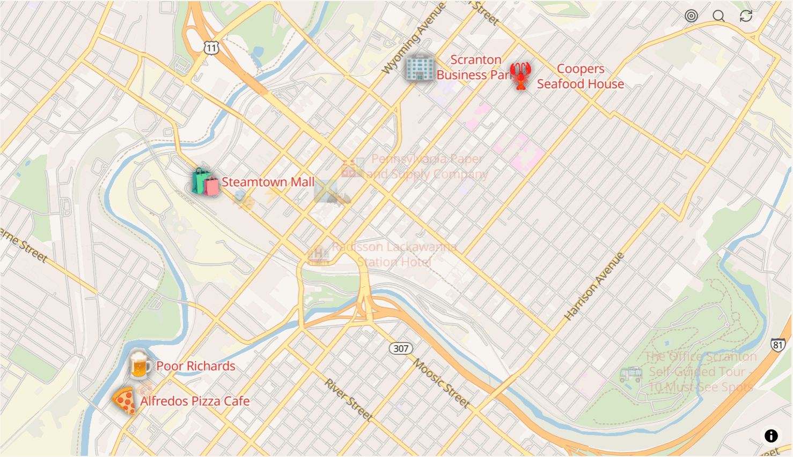

# Places

Manage points of interest, GPX and GeoJSON data in Obsidian notes and visualize them on maps.

Try in a sandbox: https://sandbox.obsidian.stanton.dev/places/

## Places ecosystem

Rendering a map requires at least one plugin with the map capability.

| Plugin                                                                                   | Map | Search | Directions | Isochrones | Elevation | Snap | Track match |
| ---------------------------------------------------------------------------------------- | :-: | :----: | :--------: | :--------: | :-------: | :--: | :---------: |
| [places-freeroute](https://community.obsidian.md/plugins/places-freeroute)               |     |        |    yes     |    yes     |           | yes  |             |
| [places-geoapify](https://community.obsidian.md/plugins/places-geoapify)                 | yes |  yes   |    yes     |    yes     |    yes    | yes  |             |
| [places-leaflet](https://community.obsidian.md/plugins/places-leaflet)                   | yes |        |            |            |           |      |             |
| [places-mapbox](https://community.obsidian.md/plugins/places-mapbox)                     | yes |  yes   |    yes     |    yes     |    yes    | yes  |             |
| [places-maptiler](https://community.obsidian.md/plugins/places-maptiler)                 | yes |  yes   |            |            |    yes    |      |             |
| [places-nominatim](https://community.obsidian.md/plugins/places-nominatim)               |     |  yes   |            |            |           |      |             |
| [places-openfreemap](https://community.obsidian.md/plugins/places-openfreemap)           | yes |        |            |            |           |      |             |
| [places-openrouteservice](https://community.obsidian.md/plugins/places-openrouteservice) |     |  yes   |    yes     |    yes     |    yes    | yes  |             |
| [places-radar](https://community.obsidian.md/plugins/places-radar)                       | yes |  yes   |    yes     |            |           |      |             |
| [places-stadia](https://community.obsidian.md/plugins/places-stadia)                     | yes |  yes   |    yes     |    yes     |    yes    | yes  |     yes     |
| [places-thunderforest](https://community.obsidian.md/plugins/places-thunderforest)       | yes |        |            |            |           |      |             |
| [places-utilities](https://community.obsidian.md/plugins/places-utilities)               |     |        |            |            |           |      |     yes     |
| [places-environment](https://community.obsidian.md/plugins/places-environment)           |     |        |            |            |           |      |             |

Search covers geocoding and POI lookup. Elevation replaces missing or inaccurate elevation
in a track. Snap corrects a track's geometry against the road or path network. Track match
identifies the named ways a track follows, with the distance and the share of the track
spent on each.

`places-leaflet` renders raster tiles; the other map providers render vector tiles.
places-environment supplies tide, solar, and weather data as charts, tables, templates, and
map data. `places-utilities` adds track classification, naming, playback, and editing.

## Network requests

| Area                                   | Request                                        |
| -------------------------------------- | ---------------------------------------------- |
| Vector tile overlay source             | Loads the TileJSON describing the tile source  |
| Image overlay                          | Fetches the image and inlines it as a data URL |
| GPX, GeoJSON, CSV, or polyline overlay | Fetches the overlay content                    |

## Background tasks

| Task                      | Schedule                      | Purpose                                                                    |
| ------------------------- | ----------------------------- | -------------------------------------------------------------------------- |
| Map restore check         | Every 2 seconds               | Restores map surfaces that lost their WebGL context                        |
| Frequency analysis worker | While a heatmap block renders | Runs heatmap overlap analysis in a Web Worker, off the main thread         |
| Query parameter playback  | While a parameter is playing  | Advances an animated query parameter at the interval the parameter defines |

## Dependencies

| Library                                                                      | Purpose                                                      |
| ---------------------------------------------------------------------------- | ------------------------------------------------------------ |
| [Chart.js](https://github.com/chartjs/Chart.js)                              | Elevation, speed, and pace charts                            |
| [fastest-levenshtein](https://github.com/ka-weihe/fastest-levenshtein)       | String distance for track similarity and name matching       |
| [obsidian-debug-logger](https://github.com/bobstanton/obsidian-debug-logger) | Scoped logging, gated behind the developer mode setting      |
| [placeholder-resolver](https://github.com/bobstanton/placeholder-resolver)   | Resolves placeholders in label and note templates            |
| [places-shared](https://github.com/bobstanton/places-shared)                 | Shared map, overlay, routing, and utility code               |
| [zstd-wasm](https://github.com/bokuweb/zstd-wasm)                            | Zstandard compression for overlay data stored in frontmatter |

### Optional integrations

Resolved at runtime from the installed plugin.

| Plugin                                                         | Purpose                                           |
| -------------------------------------------------------------- | ------------------------------------------------- |
| [VaultQuery](https://community.obsidian.md/plugins/vaultquery) | SQL queries over vault notes as a map data source |
| [Dataview](https://github.com/blacksmithgu/obsidian-dataview)  | Dataview queries as a map data source             |
